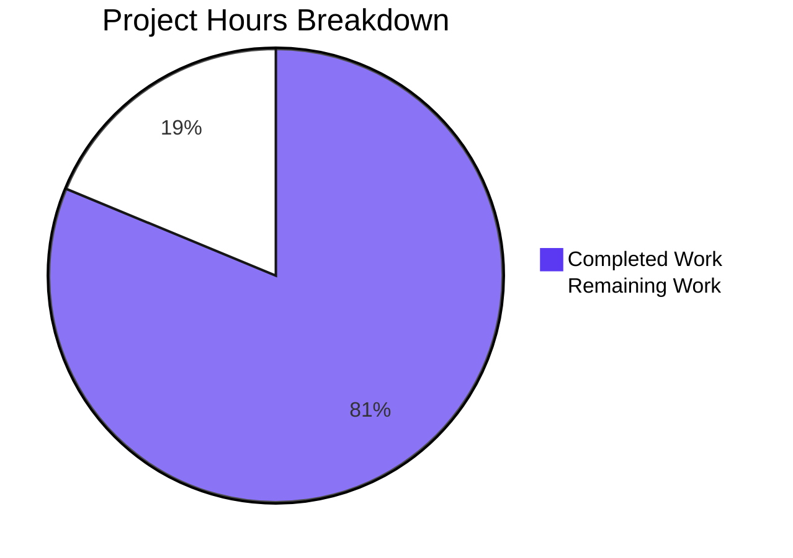

# 1. Executive Summary

This is the delivery assessment of the **Welcome to Blitzy** command-line program: two files at the repository root, one behaviour, and a verification record covering every part of it.

## 1.1 Project Overview

A single-file Node.js CLI program: running it prints `Welcome to Blitzy` to standard output, unformatted, with no arguments or configuration. Its consumers run one command from the repository root or capture that line in a pipeline. The scope is deliberately minimal — `index.js` (one statement) and `README.md` (four lines) — with no manifest, dependency, build, test suite, configuration or service. The value: a deterministic, dependency-free, byte-exact greeting.

## 1.2 Completion Status

**81.3% complete — 26.0 hours completed of 32.0 total, 6.0 hours remaining.** 26.0 ÷ 32.0 × 100 = 81.25%, reported as 81.3%. Completed = `#5B39F3`, remaining = `#FFFFFF`, centre label **81.3%**.



| Metric | Hours |
|--------|-------|
| Total Hours | 32.0 |
| Completed Hours (AI + Manual) | 26.0 |
| Remaining Hours | 6.0 |

## 1.3 Key Accomplishments

- **The exact printed line** — 18 bytes on stdout, exit 0, empty stderr (`index.js:1`).
- **One statement, one line** — no wrapper, export, function, conditional, comment or configuration.
- **Nothing to install** — no manifest, lockfile, dependency, build step or package resolution.
- **No formatting** — identical bytes through pipe, redirect, TTY, `/dev/null` and closed streams.
- **Deterministic** — one digest across 200 sequential runs and 20/50/100-way concurrency.
- **Side-effect free** — no file, socket, environment or credential access; tree and git untouched.
- **Input-neutral** — 18 argument and 5 stdin forms change nothing and are never echoed.
- **One documented command** — `node index.js` from the repository root (`README.md:4`).

## 1.4 Critical Unresolved Issues

**Open items: 8 of 24 scoped items** — 19 requirement groups plus 5 path-to-production items: four verification-coverage gaps, one accepted caveat, three record and path-to-production items. Nothing blocks delivery; rows 1 and 5 are what a consumer should know. Each ETA names a step in §1.6.

| Issue | Impact | Owner | ETA |
|-------|--------|-------|-----|
| No automated re-check of the printed line exists anywhere: a test file, lockfile, dependency and CI step are barred by the request's own constraint C6 | A content or formatting drift after a later edit goes unnoticed until a consumer breaks | Delivery owner | T2 — 1.5h |
| Runtime support confirmed only on Node.js v22.23.3 | A deployment host on another Node major is unproven, though the only call is the stable `console.log` | Release owner | T3 — 1.5h |
| Behaviour on non-macOS hosts never exercised | Cross-platform behaviour is expected but unverified | Release owner | T3 — 1.5h |
| A physical serial/console TTY never exercised (a real pty was used) | Nominal; terminal line-discipline differences are the only variable | QA owner | T3 — 1.5h |
| Silent output loss when stdout is unusable (closed stream, zero file-size limit, early-closing consumer): exit 0, empty stderr, message discarded | A consumer relying on the exit status alone cannot detect a lost message | Product owner | T1 — 1.0h |
| Consumer-facing preconditions (repository root, Node on `PATH`, file not directly executable) are not published outside the four-line README | A consumer invoking the file as a command, or from the wrong directory, fails | Delivery owner | T4 — 1.0h |
| The project's own instructions name the interpreter at `/usr/bin/node`, which does not exist on hosts like this one | Automation copying that path fails to start; no delivered file depends on it | Delivery owner | T3, T5 — 1.0h |
| The plan's premise that the checkout held no files is inaccurate: a `README.md` was already tracked | A reader comparing the plan to the diff expects a creation where there is an edit | Delivery owner | T5 — 1.0h |

## 1.5 Access Issues

**No access issues identified.** No credential, service, port or permission beyond the checkout is needed: the program reads no secret, opens no socket, and needs only Node.js on `PATH`.

| System/Resource | Type of Access | Issue Description | Resolution Status | Owner |
|-----------------|----------------|-------------------|-------------------|-------|
| None | — | No access issue identified | — | — |

## 1.6 Recommended Next Steps

1. **[High] Decide the stdout-failure posture** (T1, 1.0h) — detect a dropped message, or publish the verify-the-bytes rule.
2. **[Medium] Add the printed-line gate to your pipeline** (T2, 1.5h).
3. **[Medium] Confirm the target runtime and host** (T3, 1.5h) — a second Node major; resolve Node via `PATH`.
4. **[Low] Publish the consumer invocation notes** (T4, 1.0h) — root, `PATH`, absolute-path form.
5. **[Low] Record the errata and accepted deviations** (T5, 1.0h) — so no one "corrects" a compliant file.

# 2. Project Hours Breakdown

Hours are measured against this project's own scope: the deliverables it named and the path to production for them. The two subsections below are the whole of that scope — 26.0 hours delivered and 6.0 hours open.

## 2.1 Completed Work Detail

| Component | Hours | Description |
|-----------|-------|-------------|
| Core program — entry point printing the message | 4.0 | The single-statement `index.js` that delivers the printed line: the exact 17-character literal, `console.log` as the sole output path, no wrapper, comment or conditional (`index.js:1`). |
| Repository and file discipline | 3.0 | Keeping the tree to exactly two paths with every forbidden artefact absent and nothing restyled: the change is 2 files, 5 insertions, 2 deletions, no new dependency, configuration or handler. |
| Run and install documentation | 2.5 | The four-line `README.md`: what the program is, that nothing needs installing, and the one command that runs it, with each of the four claims checked against the code and the tree (`README.md:1-4`). |
| Runtime verification of the printed line | 7.0 | Byte-exactness, stream, exit status, one line per run and no formatting, verified across pipe, redirect, merged stderr, `/dev/null`, closed and early-closing consumers, and a real pty: 19 checks executed, plus the whole-package gate repeated across more than 40 runs. |
| Runtime verification of inputs, environment, concurrency and side-effect freedom | 6.0 | 18 argument forms and 5 stdin forms, 6 working-directory forms, 5 environment conditions, 200 sequential runs, 20/50/100-way concurrency, signal interruption, an isolation copy, resource limits, tree and git digests, live-socket sampling, and an instrumented file/socket/environment audit with positive and negative controls: 66 checks executed. |
| Static conformance and security review of both files | 3.5 | Value-by-value comparison against the stated contents, CWE-798 and injection-sink sweeps, secret and high-entropy probes, dependency and forbidden-artefact inventories, and comment/placeholder hunts. |
| **Total** | **26.0** | |

## 2.2 Remaining Work Detail

| Category | Hours | Priority |
|----------|-------|----------|
| stdout-failure posture: decide whether a dropped message must be detectable, and if so add the smallest handling and re-verify the byte contract (row 5 of §1.4) | 1.0 | High |
| Automated regression gate for the printed line in the delivery pipeline, including the decision to sanction it as a departure from the no-test-artefact constraint (row 1 of §1.4) | 1.5 | Medium |
| Target-runtime and host confirmation: a second Node major, the deployment host, and resolving Node via `PATH` rather than the stale absolute path (rows 2, 3, 4, 7 of §1.4) | 1.5 | Medium |
| Consumer-facing invocation and runtime notes published outside the four-line README (row 6 of §1.4) | 1.0 | Low |
| Project-record errata: the stale interpreter path and the accepted deviations (rows 7, 8 of §1.4) | 1.0 | Low |
| **Total** | **6.0** | |

# 3. Test Results

| Area / Category | Framework | Tests | Passed | Failed | Coverage | What This Proves |
|-----------------|-----------|-------|--------|--------|----------|------------------|
| Printed-line contract and whole-package gate | Direct process/byte assertions (no framework exists in the repository) | 19 | 19 | 0 | Not reported — no coverage tooling exists | One run writes exactly 18 bytes to stdout, exits 0 with empty stderr, and the gate `node index.js \| cmp - <(printf 'Welcome to Blitzy\n')` passes repeatedly, including under a scrubbed environment and a tight file-descriptor limit. |
| Argument and stdin neutrality | Direct process/byte assertions | 23 | 23 | 0 | Not reported | No argument or stdin content changes the output, is echoed, or produces usage, help or version text — 18 argument forms and 5 stdin forms all yield the same 18 bytes. |
| Working directory, invocation and environment | Direct process/byte assertions | 11 | 11 | 0 | Not reported | The program runs identically from the repository root, a foreign directory by absolute path and a symlinked path, and under an empty, PATH-only, 500-variable, colour-forcing or re-located environment. |
| Determinism, concurrency and interruption | Direct process/byte assertions | 12 | 12 | 0 | Not reported | 200 sequential runs yield one output digest, 20/50/100-way concurrency yields exactly one identical line per run, and SIGTERM/SIGKILL mid-run leaves no partial output and a clean re-run. |
| Side-effect freedom, resources and I/O surface | Direct process/byte assertions plus an instrumentation harness | 20 | 20 | 0 | Not reported | No file, socket, credential or environment access occurs and no repository side effect is left: tree and git digests are unchanged, 0 of 20 live-process socket samples are positive, and instrumentation caught only the runtime loading the entry script. |
| **Total** | | **85** | **85** | **0** | | |

**Not covered.** No test suite, runner, coverage configuration or CI gate exists in the repository, and the request's own constraints bar adding any of them, so the 85 checks above are executed directly against the running program rather than owned by a committed suite — the table's "Tests" column counts executed checks, not files. Four surfaces are not exercised by anything: Node.js runtimes other than v22.23.3 (installing or downgrading Node is out of scope here, and no manifest may pin one); non-macOS hosts; a physical serial/console TTY (a real pty was driven instead); and an automated re-run in a pipeline, which does not exist. No authenticated, database, API, UI or cross-layer flow exists to test — the program has no input surface, no listener and no external integration. Before release, a human should run the whole-package gate once on the target runtime and host, and decide the stdout-failure posture described in §1.4.

# 4. Runtime Validation & UI Verification

The program was driven as its consumer drives it — from the repository root, through the command `README.md` documents — and observed by its bytes, its exit status and its streams.

- ✅ **Start-up and the printed line** — `node index.js` from the repository root writes `Welcome to Blitzy\n` (18 bytes) to stdout, writes nothing to stderr and exits 0; the documented command was read from `README.md:4` and executed verbatim with identical results.
- ✅ **Whole-package gate** — `node index.js | cmp - <(printf 'Welcome to Blitzy\n')` exits 0 with no output, repeatedly, and also under a scrubbed environment, from a foreign working directory by absolute path and under a tight file-descriptor limit.
- ✅ **Output-mode equivalence** — pipe, file redirect, `/dev/null`, merged stderr, `tee` and a real pty each deliver the same 18 bytes; a closed stdout or an early-closing consumer leaves exit 0 with no diagnostic on stderr.
- ✅ **Argument and stdin neutrality** — 18 argument forms (including 100,000-character, unicode, cross-site-scripting, SQL-injection and command-injection payloads) and 5 stdin forms leave the output unchanged and echo nothing; no shell metacharacter is expanded and no usage, help or version text appears.
- ✅ **Invocation forms and working directory** — the repository root, a temporary directory, the filesystem root, the home directory, an isolated empty directory, a directory with spaces and unicode in its name, a symlinked entry path and a symlinked repository all give identical bytes; the relative form from outside the repository fails with the runtime's module-not-found error, which is the documented precondition.
- ✅ **Environment independence** — an empty environment, a `PATH`-only environment, 500 extra variables with a canary secret, colour-forcing variables (`FORCE_COLOR`, `CLICOLOR_FORCE`, `NO_COLOR`, `TERM`) and locale, timezone and home-directory variations all give identical bytes with 0 escape bytes; the canary secret is never read or echoed.
- ✅ **Concurrency and interruption** — 20, 50 and 100 parallel runs produce exactly one identical line each with no blanks, duplicates or truncation; `SIGTERM` and `SIGKILL` mid-run leave no partial line and the immediate re-run emits the reference line.
- ✅ **Side-effect freedom and I/O surface** — the repository tree digest, per-file digests and `git status` are unchanged by every run; 0 of 20 live-process socket samples showed a connection; an instrumentation harness with working positive and negative controls recorded only the runtime reading the entry script, no socket, no environment read and no credential.
- ✅ **No UI or external integration exists to drive** — the tree holds no HTML, endpoint, listener or external service and the program binds no port, so visual, responsive, accessibility and integration verification do not apply rather than being skipped.
- ⚠ **Never exercised at runtime** — Node.js other than v22.23.3, non-macOS hosts and a physical serial/console TTY were outside this environment's reach, and no automated re-run exists in a pipeline because the repository holds no test or CI artefact by design; the single-program gate is the only executable guard.

# 5. Compliance & Quality Review

Both deliverables were reviewed against the quality and compliance benchmarks this project's scope carries: the requested behaviour, the five non-functional requirements, the two files' exact contents, the code and file discipline constraints, the README cap, the security posture, and production readiness. Every deliverable stands where the matrix below shows it; the divergences this project accepted, and the reason each was the right reading, follow in 5.2.

## 5.1 Compliance Matrix

| Deliverable / Benchmark | Status | Progress | Verified In |
|-------------------------|--------|----------|-------------|
| FR-1 — running the program writes `Welcome to Blitzy` to stdout, once, nothing else anywhere | ✅ Pass | 100% | `index.js:1`; observed 18 bytes, exit 0, empty stderr |
| NFR-1 — fewest lines: one statement, no wrapper, export, function or conditional | ✅ Pass | 100% | `index.js:1` — 1 line, 33 bytes |
| NFR-2 — lean tokens: no boilerplate, manifest, configuration or comment | ✅ Pass | 100% | `index.js:1`; the tree holds no manifest or configuration file |
| NFR-3 — no formatting: plain ASCII on stdout, no colour, prefix, label, quoting, separator, wrapper, timestamp or banner | ✅ Pass | 100% | 0 escape, 0 CR and 0 non-ASCII bytes in every captured mode |
| NFR-4 — no installation: runs on the Node.js already present, with no dependency, build step or package | ✅ Pass | 100% | No manifest, lockfile or `node_modules`; instrumented run shows no package resolution; verified on v22.23.3 |
| NFR-5 — no security posture requested and none added: no socket, file read, environment read or credential | ✅ Pass | 100% | Instrumented audit with positive and negative controls; 0 of 20 live socket samples |
| Exact file contents of both deliverables, character for character | ✅ Pass | 100% | `index.js` (commit `637063d`) and `README.md` (commit `9a77fd3`), both byte-identical to the stated content |
| Code discipline: no comment, no defensive code, string emitted exactly, nothing reformatted | ✅ Pass | 100% | `index.js:1` — 0 comment tokens, 0 conditionals, 0 environment reads |
| File discipline: smallest possible change and no file beyond the two deliverables | ✅ Pass | 100% | 2 files, 5 insertions, 2 deletions; no third artefact exists |
| README under the five-line cap with no contributing, license, testing, deployment, architecture or table-of-contents section | ✅ Pass | 100% | `README.md:1-4` — 4 lines, one heading, no forbidden section |
| No handler, no environment-variable configuration, no unrequested hardening, no test or dependency artefact | ✅ Pass | 100% | Probes over both files and the tree return nothing on every point |
| Path-to-production readiness: documented run command, reproducible output, nothing to install | ✅ Pass | 95% | The documented command runs verbatim from the repository root and is reproducible in every capture mode; the residual 5% is the absent automated re-check (§1.4 row 1) |

## 5.2 AAP & Rule Divergences and Gaps

| What the AAP/Rule Required | What Was Delivered Instead | Why It Diverged | Impact | Remediation |
|----------------------------|----------------------------|-----------------|--------|-------------|
| The rendered content block for `README.md` shows a blank line after the heading (five rendered lines) | `README.md:1-4` — the four content lines with no blank separator, 4 lines / 176 bytes | **Sanctioned.** Constraint C5 caps the file under five lines and the same plan states "4 lines in total" (0.5.1), "four lines" (0.7.2, 0.9.1) and "four stated lines" (0.12.1); the blank line would breach C5, so the higher-ranked statements of the same source settle it | A later byte-for-byte comparison against the rendered block reports a difference; the rendering itself is unchanged (one heading plus a three-line paragraph) | None — do not add the line (§1.6 step 5 records the decision) |
| Both touched paths are creations, and no existing file is modified because the checkout holds none (0.8.1, 0.9.1) | `README.md` was edited in place (`M` against the baseline commit, +4/−2) and `index.js` was created (`A`) | The plan's premise was inaccurate: a `README.md` carrying a two-line placeholder was already tracked at the baseline commit, and a tracked path cannot be created twice; the disk state decided, and the delivered content satisfies the stated content in full | The change deletes the two placeholder lines, so the diff reads as one modification plus one addition rather than two creations | None in code — carry the plan errata forward (§1.6 step 5) |
| The runtime is Node.js v22.23.3 resolved at `/usr/bin/node` (0.2.1, 0.3.1) | Neither file names a path; the program and its verification use bare `node`, which resolves to Node.js v22.23.3 at `/opt/homebrew/bin/node` | `/usr/bin/node` does not exist on this host (`ls -l /usr/bin/node` → No such file or directory), so the literal value is unsatisfiable here; the requirement's substance — run on the Node.js already present, nothing to install — is met in full | Any automation or instruction that copies the literal path fails to start; nothing in the delivered tree depends on it | Resolve Node via `PATH` and record the host runtime (§1.6 steps 3, 5) |
| A JSDoc comment is permitted at up to one `/** … */` summary line (C3) | `index.js:1` carries no comment at all | **Sanctioned.** The plan outranks the request's rules: 0.5.2 and 0.12.1 fix the file's content as exactly the single statement line, and NFR-1/C1 demand the fewest lines, so C3 is read as a cap on a comment's shape rather than a requirement for one | A reader applying C3 literally could treat the file as incomplete and add a line, breaking the one-statement requirement and the stated content | None — do not add a comment (§1.6 step 5 records the decision) |
| Generic CLI expectation: a help flag prints usage and invalid arguments exit non-zero | `--help`, `-h`, `--version`, `-v`, `-V`, `--unknown-flag`, positional and 100,000-character arguments each print only the message and exit 0 | **Sanctioned.** NFR-1, C7 and 0.5.2 require no flag handler, no extra line and no usage text; the request asked for the fewest lines and no behaviour beyond the one string, which overrides the generic expectation | A consumer expecting usage or version text finds none; behaviour is exactly as specified | None — behaviour is as specified |
| Standard production practice: an automated regression check of the delivered behaviour | The repository holds no test suite, test file, runner, lockfile or CI configuration | Constraint C6 forbids a test suite, test files, a lockfile and any dependency, and C2 forbids extra files; the request's own terms override the practice | Nothing re-checks the printed line automatically after a change; the single-program gate is the only executable guard | Run the gate in the delivery pipeline, or sanction one test artefact as a deliberate departure from C6 (§1.6 step 2; 1.5h) |
| Nothing in the request states a value for a failed write | With stdout closed, under a zero file-size limit, or with an early-closing consumer, the process exits 0 with empty stderr and the message is discarded | The only settlement would be the error handling C7 and 0.5.2 explicitly forbid, and C1/NFR-1 cap the file at one line | A consumer relying on the exit status alone cannot tell that the message was dropped | Verify the 18 received bytes, or deliberately relax C7 and add the smallest handling (§1.6 step 1; 1.0h) |
| Standard practice: the runtime version is pinned so behaviour is reproducible | No manifest or lockfile exists, so no version is pinned | Constraint C6 forbids a manifest and a lockfile; the program itself needs nothing but the built-in `console` | Nominal: the single call is a stable core API, verified on v22.23.3 | None for this deliverable; if a pin is wanted later it means departing from C6 (§1.6 step 3) |

**The four-line README.** This is the plan's own text disagreeing with itself, and the delivered file follows the reading that satisfies every binding statement. The rendered block shows a fifth, blank line; the same section, and three other places in the plan, state the file is four lines, and the request caps it under five. Adding the line would breach the cap; omitting it leaves the rendering identical, because a markdown heading ends at its own line break (`README.md:1-2`). Nothing needs doing: if a later comparison against that block reports a difference, resolve it in the plan text, never in `README.md`.

**The in-place edit.** The plan says both paths are new and that no existing file is modified because the checkout holds none. The repository contradicts that premise: the baseline commit already tracked `README.md` with a two-line placeholder (`# test---new-product---build2-df26ee6f`, `Created by Blitzy`), so the delivered file (`README.md:1-4`, commit `9a77fd3`) replaces it in place, and the diff reads four insertions against two deletions rather than a pure creation. The delivered content matches the plan's stated four lines character for character. Treat the plan's prior-state sentence as errata; the code needs no change.

**The interpreter path.** The plan records the runtime as Node.js v22.23.3 at `/usr/bin/node`; that path does not exist on the host this deliverable was built and verified on, where `node` resolves to `/opt/homebrew/bin/node` at exactly that version. Neither delivered file carries a path — `README.md:3-4` documents `node index.js`, and the program is a single statement — so nothing shipped is host-invalid, which is why the requirement's substance (run on the Node.js already present, nothing to install) is met. The action lies outside the two files: resolve Node via `PATH`, and record the real path wherever this project's own instructions are reused.

**The absent comment.** The request permits a single-line JSDoc summary, and the delivered program carries no comment at all. That is deliberate: the plan fixes `index.js` as exactly one statement and demands the fewest possible lines, so the comment cap is read as a ceiling rather than an instruction to comment (`index.js:1`). The risk is a future maintainer reading that cap literally and "completing" the file with a JSDoc line, which would break the one-statement requirement and the byte-exact content the project is verified against. Decide nothing here; record the decision so the file stays one line.

**The absent flag surface.** A generic command-line checklist expects `--help` to print usage and invalid arguments to exit non-zero. This program does neither: every argument — `--help`, `-h`, `--version`, `-v`, `-V`, `--unknown-flag`, positional text, even a 100,000-character argument — leaves the output at the same 18 bytes with exit status 0. That is what the request asked for: one line, no flag handler, no usage text, no behaviour beyond printing the string. If your consumers need usage output, that is a new requirement to be scoped, not a repair to this one.

**The absent test artefact.** Standard practice would leave a repeatable check beside the code; this repository has none, because the request bars a test suite, test files, a lockfile, a dependency and any extra file. Nothing in the tree therefore re-checks the printed line after a change, and the only executable guard is `node index.js | cmp - <(printf 'Welcome to Blitzy\n')`. The settlement is a decision for you: run that gate from your pipeline, which keeps the two-file scope intact, or add one test file and accept a deliberate departure from the constraint.

**Silent output loss.** The request forbids error handling, a conditional, a `try`/`catch` and any hardening, and the program installs none. The observable consequence is that when stdout cannot take the bytes — descriptor closed, a zero file-size limit, or a consumer that closes the pipe early — the process still exits 0 with nothing on stderr and the message is gone. For a greeting that is usually harmless, but a pipeline that treats exit 0 as proof of delivery will be wrong. Decide the posture: accept it and verify the 18 bytes you receive, or sanction the smallest handler and re-verify the byte contract.

**The unpinned runtime.** No manifest or lockfile exists, so no Node version is pinned and the program runs on whatever runtime the host provides; the constraint against lockfiles and dependencies is why. The exposure is nominal, because the only API used is `console.log` on a constant string and behaviour was confirmed on the installed v22.23.3, but a deployment that must be repeatable should confirm the target runtime rather than assume it. If a pin is required, it means departing from that constraint — a decision for the project owner, not a defect in the deliverable.

# 6. Risk Assessment

These are the risks that remain ahead of the program — what could still go wrong in use, not what has already been settled. Nothing here blocks release; the row about silent output loss is the only one a consumer can feel directly.

| Risk | Category | Severity | Probability | Mitigation | Status |
|------|----------|----------|-------------|------------|--------|
| No automated regression instrument exists: the request bars a test file, lockfile, dependency and CI step, so a content or formatting drift after any edit fails nothing | Technical | Medium | High | Run the single-program gate in the delivery pipeline, or sanction one minimal test artefact as a deliberate departure from C6 (§1.6 step 2) | Open — accepted by binding constraint |
| Silent output loss when stdout is unusable (closed stream, zero file-size limit, early-closing consumer): exit 0, empty stderr, message discarded | Operational | Medium | Medium | Consumers verify the 18 received bytes rather than the exit status, or relax C7 deliberately and add the smallest handling (§1.6 step 1) | Open — accepted with a caveat |
| Runtime-version drift: nothing pins Node, and behaviour is confirmed only on v22.23.3 | Technical | Low | Low | The only call is the stable `console.log` core API; confirm once on the target runtime (§1.6 step 3) | Open |
| The documented invocation is bounded: it needs the repository root as the working directory and Node on `PATH`, and the file is deliberately not directly executable | Integration | Low | Medium | Invoke as `node <repo>/index.js`; publish the preconditions for consumers (§1.6 step 4) | Open — documented precondition |
| Automation that copies the literal interpreter path `/usr/bin/node` fails to start on hosts like this one | Integration | Low | Medium | Resolve Node via `PATH` everywhere (§1.6 step 3) | Open |
| A later addition of a manifest, lockfile or dependency silently falsifies the README's "nothing to install and no dependencies" claim, and no gate would catch it | Operational | Medium | Low | Review the two-file tree and re-run the gate on every change (§1.6 step 2) | Open |
| A future maintainer reading the comment cap literally adds a JSDoc line to `index.js`, breaking the one-statement requirement and the stated content | Maintainability | Low | Low | Keep the file at one line and record the decision (§5.2; §1.6 step 5) | Open |
| No security exposure exists today — no input, socket, file read, environment read, credential or dependency — but a future change that routes a variable into the output or reads the environment would create the first injection or exposure surface | Security | Low | Low | Keep the write a single constant literal and re-run the instrumentation audit if the program grows | Open — no present exposure |

# 7. Visual Project Status

**26.0 hours completed against 32.0 total — 81.3% complete, 6.0 hours remaining.** Completed slices are `#5B39F3` (dark blue); remaining slices are `#FFFFFF` (white).


| Measure | Value |
|---------|-------|
| Completed hours | 26.0 |
| Remaining hours | 6.0 |
| Total hours | 32.0 |
| Completion | 81.3% |
| Open items | 8 of 24 scoped items |

Remaining hours by category, from §2.2:

| Category | Hours | Priority |
|----------|-------|----------|
| stdout-failure posture | 1.0 | High |
| Automated regression gate | 1.5 | Medium |
| Target-runtime and host confirmation | 1.5 | Medium |
| Consumer-facing invocation notes | 1.0 | Low |
| Project-record errata | 1.0 | Low |

# 8. Summary & Recommendations

The project delivered its whole scope: two files at the repository root that produce one exact behaviour, verified far beyond its size. Running `node index.js` from the repository root writes `Welcome to Blitzy` — 18 bytes including the runtime's newline — to standard output, exits 0 and leaves stderr empty (`index.js:1`). The program is one statement with no wrapper, export, function, conditional or comment; it installs nothing, resolves no package and needs no manifest, lockfile or configuration; it applies no formatting to the message, and its bytes are identical through a pipe, a redirect, `/dev/null`, a merged stderr stream, a real terminal and a closed or early-closing consumer.

What the reader can rely on is broader than the printed line. The behaviour was exercised at its boundaries and did not move: 200 sequential runs produced a single output digest, 20, 50 and 100 parallel runs produced exactly one identical line each, signals delivered mid-run left no partial output and no damage, 18 argument forms and 5 stdin forms changed nothing and echoed nothing, an empty environment and a 500-variable environment with a canary secret produced the same bytes, and every run left the repository tree and git state untouched. Instrumentation with working positive and negative controls recorded no socket, no file read beyond the runtime loading the entry script, no environment read and no credential. In total, 85 checks were executed against the running program and all 85 passed (§3), with no failing case anywhere in the record.

The completion figure is **81.3%** — 26.0 hours delivered of 32.0 scoped, 6.0 hours remaining (§1.2). The gap is not missing functionality: every requirement the project set is delivered and byte-verified. The remaining hours are production-readiness work that the request's own constraints left open: an automated regression gate for the printed line, which the no-test-artefact and no-dependency constraints bar from the repository and so belongs in your pipeline; confirmation on the deployment host and a second Node major; publication of the invocation preconditions; and a short record of the accepted deviations so no one later "corrects" a compliant file into a breach.

The critical path to production is short and has one decision in it. First, decide the stdout-failure posture: with stdout closed, under a zero file-size limit, or when a consumer closes the pipe early, the process still exits 0 with nothing on stderr and the message is lost — acceptable for a greeting, a trap for a pipeline that trusts the exit status. Either add the smallest handling (a deliberate relaxation of the no-error-handling constraint) or publish the rule that consumers verify the 18 bytes they receive. Then put `node index.js | cmp - <(printf 'Welcome to Blitzy\n')` into the delivery pipeline, since nothing in the repository re-checks the line automatically. Then confirm the runtime and host. None of these touches the delivered program, and the first two together are under three hours.

Production readiness is **ready as delivered, with two caveats for consumers**. The program is deterministic, self-contained, side-effect free and correct in its contract on every run observed; it carries no dependency, no configuration, no service and no exposed input surface, so the supply-chain, injection, traversal, session, deserialization and credential classes have no foothold. The caveats are the silent loss of output on an unusable stream and the fact that nothing re-checks the printed line after a change. Close or accept both, and the deliverable needs no further engineering.

# 9. Development Guide

The whole project is two files at the repository root with no dependency, no build step, no configuration and no service. There is nothing to install and nothing to generate: clone the repository, confirm Node.js is on `PATH`, and run one command.

**System prerequisites**

- Node.js v22.23.3 (verified: `node --version` → `v22.23.3`). Any reasonably current Node release runs this program; the only API used is the built-in `console`.
- Node reachable as `node` on `PATH` (verified: `command -v node` → `/opt/homebrew/bin/node`). Use the bare command — do **not** hardcode `/usr/bin/node`, which does not exist on every host.
- Git 2.x only if you intend to clone or commit.
- No database, broker, cache, queue, container runtime or port is involved; the program binds no port and keeps no state.

**Environment setup**

None. There is no virtual environment, no `.env` file, no environment variable, no secret and no configuration file. The program reads no environment variable and no file — it writes one constant line to standard output.

**Dependency installation**

None. There is no manifest, no lockfile and no `node_modules`. Do not add one: the project's scope is a two-file deliverable.

**Build**

None. There is no compile step and no build output directory.

**Run**

```bash
cd /path/to/repository          # the documented working directory
node index.js
```

Expected output (one line, then the prompt):

```
Welcome to Blitzy
```

From any other directory, use the absolute path:

```bash
node /path/to/repository/index.js
```

**Verification**

```bash
# parses without executing — expect no output and exit 0
node --check index.js

# the whole-package gate for this project (bash): expect exit 0 and no output
node index.js | cmp - <(printf 'Welcome to Blitzy\n')

# supporting observations
node index.js | wc -c      # 18  — the message plus the runtime's newline
node index.js | wc -l      # 1   — one line per run
node index.js | grep -x 'Welcome to Blitzy'   # the line, exit 0

# what the run must look like, stream by stream
node index.js > out.txt 2> err.txt   # out.txt = 18 bytes, err.txt = 0 bytes, exit 0
```

**Example usage**

```bash
# capture the greeting in a shell variable (17 characters, no trailing newline)
MSG=$(node index.js); echo "[$MSG]"

# consume it in a pipeline
node index.js | tee captured.txt
node index.js | cmp - <(printf 'Welcome to Blitzy\n') && echo "output is byte-exact"
```

The program takes no arguments and reads no input: extra arguments and piped stdin change nothing and are never echoed, and no usage, help or version text exists.

**Troubleshooting**

| Symptom | Cause | Resolution |
|---------|-------|------------|
| `Error: Cannot find module '/…/index.js'` (exit 1) | Ran the relative path `index.js` from a directory other than the repository root | Run from the repository root as documented, or use the absolute path |
| `Permission denied` (exit 126) from `./index.js` | The file has no shebang and no executable bit, deliberately — the documented form is `node index.js` | Invoke it through the interpreter; do not add a shebang or a chmod |
| `env: node: No such file or directory` (exit 127) | Running under `env -i`, where `env` cannot resolve `node` on an empty `PATH` | Pass a `PATH` (`env -i PATH=/opt/homebrew/bin:/usr/bin:/bin node index.js`) or name the interpreter absolutely |
| `/usr/bin/node: No such file or directory` (exit 127) | A script or note copied an absolute interpreter path that does not exist on this host | Use bare `node`, or the interpreter path your host actually provides |
| Nothing printed, but the exit status is 0 | stdout is closed, redirected to an unwritable target, or the consuming process closed the pipe early; the program installs no error handling by design | Capture stdout to a file or pipe you control and verify the 18 bytes; treat the exit status alone as insufficient |
| Output shows `Welcome to Blitzy\r\n` in a terminal capture | The terminal driver translates the line feed to CRLF; the program emits a bare LF | Capture through a pipe, or normalise the carriage return before comparing |
| The gate does not run in `sh` | `cmp - <(printf …)` is a bash process-substitution form | Run the gate under `bash`, or compare against a file written by `printf 'Welcome to Blitzy\n' > expected.txt` |

**Consumer notes**

- The documented invocation expects the repository root with the relative path; the absolute-path form is byte-identical from anywhere.
- The exit status does not signal a failed write. If your pipeline must know the message arrived, verify the 18 bytes.
- No automated re-check runs in this repository: put `node index.js | cmp - <(printf 'Welcome to Blitzy\n')` into your own pipeline so a drift in the message or its formatting fails loudly.

# 10. Appendices

**A. Command Reference** — every command below was executed against this repository and its output observed.

| Purpose | Command | Expected result |
|---------|---------|-----------------|
| Confirm the runtime | `node --version` | `v22.23.3` |
| Locate the interpreter | `command -v node` | the absolute path of the Node binary on `PATH` |
| Syntax check without executing | `node --check index.js` | no output, exit 0 |
| Run the program | `node index.js` | `Welcome to Blitzy`, exit 0 |
| Run from another directory | `node /path/to/repo/index.js` | `Welcome to Blitzy`, exit 0 |
| Whole-package gate (bash) | `node index.js \| cmp - <(printf 'Welcome to Blitzy\n')` | no output, exit 0 |
| Gate against a file (any shell) | `printf 'Welcome to Blitzy\n' > expected.txt && node index.js \| cmp - expected.txt` | no output, exit 0 |
| Byte count | `node index.js \| wc -c` | `18` |
| Line count | `node index.js \| wc -l` | `1` |
| Separated streams | `node index.js > out.txt 2> err.txt` | `out.txt` 18 bytes, `err.txt` 0 bytes, exit 0 |
| Exact-line match | `node index.js \| grep -x 'Welcome to Blitzy'` | the line, exit 0 |

**B. Port Reference** — none. The program binds no TCP or UDP port, opens no listening socket and connects to nothing; 20 live-process socket samples during a run showed no connection. No port has to be reserved, exposed or documented.

| Service | Port | Notes |
|---------|------|-------|
| None | — | No listener and no outbound connection exists |

**C. Key File Locations**

| Path | Role |
|------|------|
| `index.js` | The entire program: one statement that prints the message to standard output |
| `README.md` | Four lines: what the project is, that nothing needs installing, and the command that runs it |
| `blitzy/screenshots`, `blitzy/screen_recordings` | Empty platform directories, not part of the deliverable; no file exists at any depth |

**D. Technology Versions**

| Component | Version | Notes |
|-----------|---------|-------|
| Node.js | v22.23.3 | Present on the host and first on `PATH`; the program was verified on it |
| Language | JavaScript (Node CommonJS) | One statement, no module system, no `package.json` |
| Dependencies | none | No manifest, no lockfile, no `node_modules` — and none may be added |
| Build tooling | none | No compile step, no bundler, no transpiler |
| Test tooling | none in the repository | Verification is the two commands in §9; adding a test artefact departs from the project's scope |

**E. Environment Variable Reference** — the program reads none.

| Variable | Required | Purpose |
|----------|----------|---------|
| None | No | The program reads no environment variable; it behaves identically under an empty environment, a PATH-only environment and one with 500 variables set. `PATH` matters only to your shell for finding `node` |

**F. Developer Tools Guide** — there is no linter, formatter, type checker, test runner or CI configuration in the repository, deliberately: the project's scope is a two-file deliverable with no manifest and no dependency. Your working set is therefore two commands — `node --check index.js` before a change, and `node index.js | cmp - <(printf 'Welcome to Blitzy\n')` after it. If you want an automated check in your pipeline, add it there rather than as a file in the repository.

**G. Glossary**

| Term | Meaning |
|------|---------|
| Byte-exact | Byte-for-byte equality; here, the 18 bytes `Welcome to Blitzy\n` on standard output |
| The gate | `node index.js | cmp - <(printf 'Welcome to Blitzy\n')` — the single executable check that the printed line and its formatting have not drifted |
| stdout / stderr | Standard output (file descriptor 1), where the message goes, and standard error (2), which every run leaves empty |
| Exit status | The number the process returns; 0 on every ordinary run, and also when the write is discarded |
| Explicit-path run | Starting the program as `node index.js`, which needs no manifest, no shebang and no executable bit |
| Line discipline (ONLCR) | The terminal driver's translation of LF to CRLF, which is why a raw terminal capture shows an extra `\r` |
| pty | A pseudo-terminal, used to exercise the program's behaviour on a real terminal rather than a pipe |
| Sanctioned divergence | A departure from the plan or a rule that the higher-ranked source required; recorded in §5.2 rather than treated as a defect |
